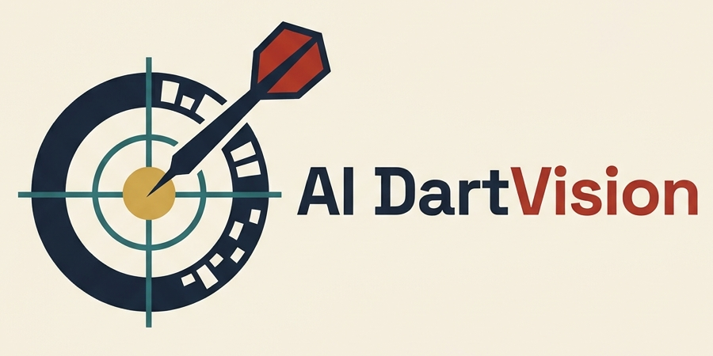
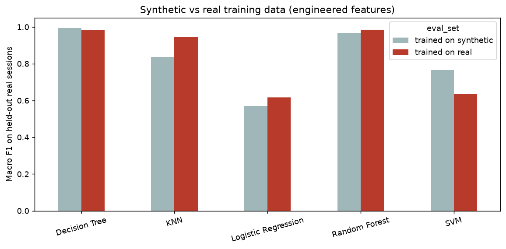

<div align="center">



### Coordinates in. Scoring regions out.

Machine-learning dartboard score prediction and player performance analysis,
tested on real throws from IEEE DataPort and paired with a grounded GenAI coach.


</div>

---

## Overview

AI DartVision takes the **(x, y) point where a dart lands** and returns its **scoring region and points** (for example `T20` = 60), then analyses accuracy across many throws.

Five machine-learning classifiers learn the scoring mapping and are compared fairly against a **deterministic geometry scorer** that applies the official board rules. The models are trained on synthetic data and then tested on **16,536 real darts** from the DeepDarts dataset (IEEE DataPort). A **Google Gemini coach** turns each player's statistics into feedback, and every number it writes is checked against the data.

**Key result:** a Decision Tree trained *only on synthetic points* scores **99.86%** of real darts correctly, on 11 throwing sessions it never saw.

## Results

Accuracy with engineered features (`x, y, r, sin θ, cos θ`). "Real" = 4,146 darts from 11 held-out DeepDarts sessions.

| Model | Synthetic test | Real darts, trained on synthetic | Real darts, trained on real |
| --- | ---: | ---: | ---: |
| Decision Tree | 99.75% | **99.86%** | 99.37% |
| Random Forest | 99.68% | 98.55% | **99.45%** |
| K-Nearest Neighbours | 95.37% | 90.11% | 97.61% |
| Support Vector Machine | 93.84% | 86.49% | 91.85% |
| Logistic Regression | 74.83% | 66.79% | 91.58% |
| Geometry baseline (rules) | 100% | 100% | 100% |

- **Synthetic training transfers to reality.** Balanced synthetic coverage of all 63 regions works as well as real data, and better for rare regions such as the bull.
- **Feature engineering matters most on real throws.** With raw `(x, y)` only, Random Forest drops from 98.55% to 90.11% on real darts.
- The geometry baseline is 100% by construction: it is the rule set that produced the labels, so it serves as the reference.

<p align="center"></p>

## Features

| Area | What it does |
| --- | --- |
| **Prediction** | Type or click a landing point and get the region, score and model confidence, checked against the board rules |
| **Model scorecard** | 5 classifiers × 2 feature sets: accuracy, macro F1, wire-boundary accuracy, confusion matrices |
| **Real data** | DeepDarts photos converted to board coordinates with a homography through 4 calibration points |
| **Player analysis** | Hit rate, 3-dart average, bias (for example "low & left"), spread, heatmaps and session trends |
| **AI Coach** | Gemini feedback in English, Hindi or Punjabi, in 3 tones, read aloud on request; every number verified, one retry, safe fallback |
| **Batch scoring** | Upload a CSV of throws, score every dart, flag disagreements, download the results |

## How it works

```
Synthetic points ─┐
Simulated players ├─► Preprocessing ─► 5 ML classifiers ─┐
DeepDarts photos ─┘   (validate,       Geometry rules ───┴─► Region + points ─► Scorecard · Player analysis · AI Coach
  (homography)         r, sin θ, cos θ)
```

1. **Board geometry:** centre (0, 0), y up, outer double ring r = 1.0 (170 mm). WDF/BDO dimensions, 20 sectors of 18°, 63 labels (IB, OB, S1–S20, D1–D20, T1–T20, MISS).
2. **Data:** 15,750 stratified synthetic points (250 per region), 5,000 uniform points, 5 simulated players, and 16,536 real DeepDarts darts.
3. **Models:** Logistic Regression, Decision Tree, Random Forest, KNN and SVM, each in a scikit-learn pipeline with the same scaler, split and labels.
4. **Evaluation:** a stratified synthetic hold-out, plus a session-level split of the real data, so whole sessions are unseen at test time.
5. **GenAI coach:** facts are computed in Python, Gemini rewrites them as JSON, every decimal, % and mm value is verified, and each attempt is logged to measure grounding.

## Quick start

```bash
git clone https://github.com/Am-berneal/AI-DartVision.git
cd AI-DartVision
python -m venv venv
venv\Scripts\activate          # Windows  (macOS/Linux: source venv/bin/activate)
pip install -r requirements.txt
```

**Optional, real data.** Download the [DeepDarts dataset](https://ieee-dataport.org/open-access/deepdarts-dataset) from IEEE DataPort and place `labels.pkl` in `data/deepdarts/`, then:

```bash
python prepare_real_data.py    # converts labels to data/real_throws.csv
```

**Train and evaluate** (about 75 seconds; trained models are not stored in the repo):

```bash
python run_pipeline.py
```

**Run the web app:**

```bash
uvicorn api:app --reload       # open http://127.0.0.1:8000
```

Or run the Streamlit demo with `streamlit run app.py`.

**Optional, GenAI coach.** Create a `.env` file in the project folder:

```text
GEMINI_API_KEY=your-key-from-aistudio.google.com
```

Without a key, the coach uses rule-based feedback built from the same verified statistics.

## Project structure

```
AI-DartVision/
├── dartvision/            core package
│   ├── board.py           board geometry + geometry scorer
│   ├── data.py            synthetic data + simulated players
│   ├── preprocessing.py   validation, normalisation, r / sin θ / cos θ
│   ├── models.py          5 classifiers + geometry baseline
│   ├── evaluate.py        metrics, boundary accuracy, confusion matrix
│   ├── players.py         player summaries and session trends
│   ├── plots.py           dartboard drawing and figures
│   ├── coach.py           Gemini coach with number verification
│   ├── deepdarts.py       DeepDarts loader + homography conversion
│   └── realdata.py        real-data experiments
├── frontend/              web app (6 pages, SVG dartboard, animations)
├── notebooks/             dataset and EDA notebook
├── tests/                 15 pytest tests
├── results/               metrics, evaluation report, figures
├── api.py                 FastAPI server + JSON API
├── app.py                 Streamlit app
├── run_pipeline.py        end-to-end pipeline
└── prepare_real_data.py   DeepDarts → board coordinates
```

## Testing

```bash
python -m pytest
```

The tests cover the geometry scorer, the dataset coverage, the coach's number verification and fallback, and the homography conversion.

## Limitations

- Dart scoring is deterministic, so the ML models are an algorithm comparison against the rules, not a replacement for them.
- Real labels come from annotated tip positions scored with the board rules; the DeepDarts paper reports 97.6% agreement with recorded scores.
- DeepDarts has no player names or aim targets, so player analysis uses simulated players.
- Version 1 takes coordinates as input; detecting darts in photos is future work.

## Roadmap

- [ ] Dart-tip detection from board photos (OpenCV / keypoints)
- [ ] Gemini vision evaluated against DeepDarts labels
- [ ] Recorded throws from named players for real player analysis
- [ ] Cross-validation, hyperparameter tuning and noise-robustness tests

## Dataset and citation

This project uses the DeepDarts dataset. The dataset is **not** redistributed in this repository; please download it from IEEE DataPort.

```bibtex
@data{mcnally2021deepdarts,
  author    = {McNally, William and Walters, Pascale and Vats, Kanav and Wong, Alexander and McPhee, John},
  title     = {DeepDarts Dataset},
  publisher = {IEEE Dataport},
  year      = {2021},
  doi       = {10.21227/05e7-xs69}
}
```

W. McNally et al., "DeepDarts: Modeling Keypoints as Objects for Automatic Scorekeeping in Darts using a Single Camera," CVPR Sports Workshop, 2021.

## Authors

**Ishaan Garg** and **Amberneal Singh**
